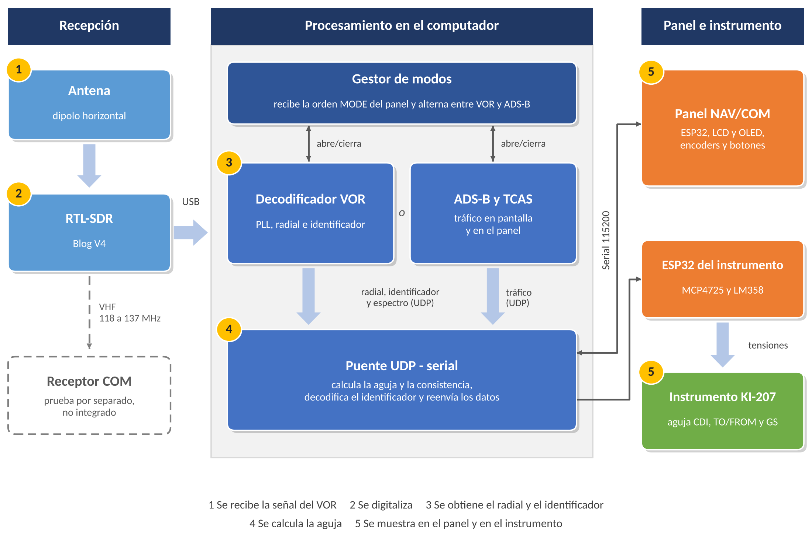

# Banco de navegación VOR / ADS-B con indicador KI-207

Proyecto de grado de Ingeniería Aeronáutica, Universidad de San Buenaventura, Bogotá.
Autores: Santiago Arias y Axel Corredor. Director: Edgar Chaves.

Sistema que recibe señales VOR reales con un RTL-SDR y un dipolo, calcula el radial con un
decodificador basado en PLL en GNU Radio y lo muestra en un panel NAV/COM (ESP32) y en un
indicador Bendix/King KI-207 real. Con el mismo receptor, en otro modo, muestra tráfico
ADS-B con alertas TA/RA simuladas.

**Versión:** v1.0-revision (octubre de 2026). Es la versión entregada a revisión; puede cambiar en la entrega final.

## Arquitectura

## Contenido

### `pc/` (se ejecuta en el computador)

| Archivo | Función |
|---|---|
| `iniciar_vor.bat` | Lanzador: abre el puente y el gestor del SDR con los ajustes de `config_vor.bat` |
| `config_vor.bat` | Ajustes del usuario: puertos serie, frecuencia, ganancias, offset, posición ADS-B |
| `vor_udp_bridge.py` | Puente entre el decodificador, el panel y el KI-207: calcula desviación y TO/FROM, envía por serie y decodifica el identificador Morse |
| `gestor_sdr.py` | Arranca el decodificador VOR y cambia al receptor ADS-B (y viceversa) cuando el panel lo pide |
| `vor_radial_decoder_pll.py` | Decodificador VOR: filtros, PLL de referencia y variable, radial por diferencia de fase |
| `adsb_tcas.py` | Receptor ADS-B a 1090 MHz: preámbulo, CRC, decodificación con pyModeS y alertas simuladas |
| `morse_ident_decoder.py` | Decodifica el identificador Morse de la estación a partir de la envolvente del tono |
| `ver_radial.py` | Visor del radial recibido por UDP (media circular y consistencia) |

### `gnuradio/`

| Archivo | Función |
|---|---|
| `vor_radial_pll.grc` | Cadena del decodificador VOR para abrir en GNU Radio Companion |
| `com_test.grc`, `com_test_v2.grc` | Pruebas del receptor COM (envolvente y AM síncrona) |

### `firmware/` (Arduino IDE, placas ESP32)

| Carpeta | Función |
|---|---|
| `panel_a320/` | Panel NAV/COM: LCD, OLED, dos encoders y dos botones |
| `ki207_bridge/` | Control del KI-207: tres DAC MCP4725 por TCA9548A para CDI, TO/FROM y Glide Slope |

### `pruebas/` e `historial/`

`pruebas/` contiene los programas de prueba de cada módulo (encoders, OLED, botones, enlace
serie con el ESP32, simulador de panel, pruebas del SDR). `historial/` contiene versiones
anteriores del decodificador y del puente. Se conservan como registro del desarrollo y no
hacen falta para usar el sistema.

## Requisitos

- RTL-SDR Blog V4 y dipolo horizontal
- Windows, con Python y GNU Radio (entorno radioconda), `numpy`, `pyserial`, `pyModeS` y `gr-osmosdr`
- Arduino IDE con soporte para ESP32 y las librerías `Adafruit MCP4725`, `LiquidCrystal I2C` y `U8g2`

## Uso resumido

1. Cargar los firmware de `firmware/` en los dos ESP32 (panel y KI-207).
2. Editar `pc/config_vor.bat`: puerto COM del panel (y del KI-207 si se usa), ruta de radioconda, frecuencia, offset de calibración y posición del receptor.
3. Cerrar el Monitor Serie del Arduino IDE y ejecutar `pc/iniciar_vor.bat`.
4. Cambiar entre VOR y ADS-B con la pulsación larga del encoder 2 del panel.

El procedimiento detallado está en el instructivo del documento de grado.

## Aviso

- El offset de calibración (270°) corresponde al sitio donde se hicieron las pruebas y debe recalcularse si cambia la posición de la antena.
- Proyecto académico. No apto para navegación real.

